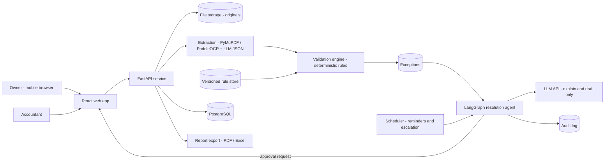

# Architecture

The LLM is used in two places only: structuring OCR text into fields, and explaining or drafting. It never computes tax, decides whether a check passed or edits a stored amount.

## Exception lifecycle (resolution agent)

Detected → Triaged → Drafted → Awaiting approval → Awaiting response → Re-validating → Resolved

- Awaiting response → **Escalated** when the follow-up timer expires
- Any open state → **Dismissed** by the owner, with a written reason

Agent tools: `get_invoice`, `get_supplier_history`, `rerun_checks`, `draft_message`, `create_owner_task`, `set_status`, `escalate_to_accountant`.
There is no tool that sends a message or edits a tax figure: messages leave only after the owner approves, and field values change only through a re-extracted document or an owner-confirmed edit.

## Data model

See [`backend/db/schema.sql`](../backend/db/schema.sql).
